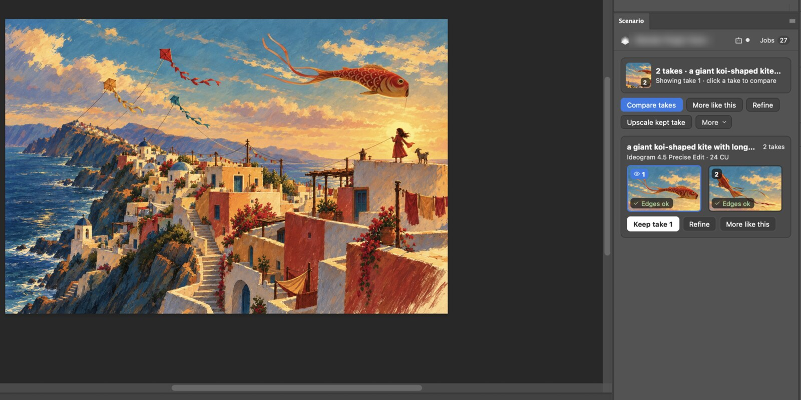
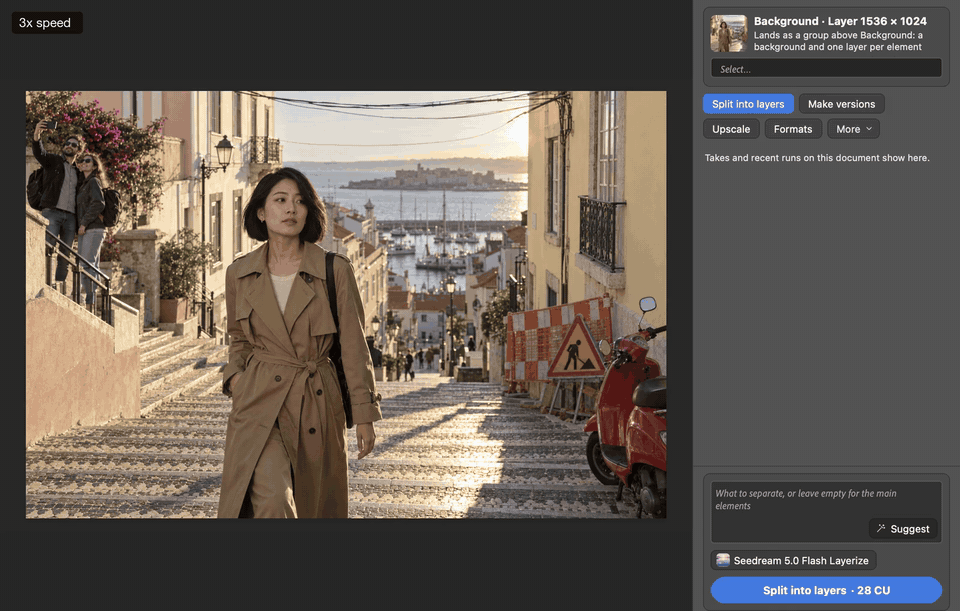

# Scenario for Photoshop

Generate, edit, upscale and cut out with [Scenario](https://www.scenario.com) models without leaving Photoshop. Select something, pick an action, see its price on the button, click. The result lands as a layer you can compare, keep or undo in one step.





*A selection edit recorded in Photoshop 27.11 (sped up 2x). [MP4](docs/media/video/selection-edit.mp4).*

> **Development build 0.7.1.** Not yet on the Adobe Marketplace, and the agent helper is not on npm yet. You install it from a `.ccx` file built from this repository.

## What it does

- **Reads what you are working on.** No document, a layer, a cut-out, a selection or a set of takes: the panel offers the actions that fit, at most six at a time, and **More** for the rest.
- **Shows the price first.** Every action button carries its price in Scenario credits (CU), checked for free before you click. Nothing is spent until you click, and a price that changes after an upload asks you again.
- **Lands results the Photoshop way.** Each run is one History state, results are smart object layers masked to your selection, takes come as a group to compare, and every layer keeps its Scenario metadata (model, prompt, settings, price).
- **Lets agents work in Photoshop.** A local Scenario MCP server, `scenario-photoshop`, lets Claude Code, Codex, Cursor or Claude Desktop read your document, run generations and land results, with an approval card in the panel before any credit is spent.

| Actions in this build | |
|---|---|
| On a selection | Replace inside (Inside selection or Bolder), Remove, Make versions, Cut out subject, Select by description |
| On a layer or image | Make versions, New layer, Extend canvas, Upscale, Remove background, Add background, Render sketch, New angle, Relight to scene, Split into layers, Remove text, Split text, Formats, Animate |
| On takes | Compare takes, Keep take, More like this, Refine, Upscale kept take |
| From your project | Place from Library, Library images as references, trained models and styles |

Before and after pictures for each action are in the [User Guide](docs/USER_GUIDE.md#actions).

## Install

You need Photoshop 2026 (27.x; tested on 27.11 on macOS) and a Scenario account on a plan with API access (Starter or above).

1. Build the package from a checkout (Node.js 20 or later):

   ```sh
   npm ci
   npm run package   # writes build/scenario-photoshop-0.7.1.ccx
   ```

2. Install it with Creative Cloud's plugin installer, then restart Photoshop (the plugin loads at the next launch):

   ```sh
   "/Library/Application Support/Adobe/Adobe Desktop Common/RemoteComponents/UPI/UnifiedPluginInstallerAgent/UnifiedPluginInstallerAgent.app/Contents/MacOS/UnifiedPluginInstallerAgent" --install "$PWD/build/scenario-photoshop-0.7.1.ccx"
   ```

   *Verified live* on macOS with Photoshop's Developer Mode on. Double-clicking the `.ccx` should do the same through Creative Cloud; *not tested*.
3. In Photoshop, open **Plugins > Scenario**.

## First generation

1. On [app.scenario.com](https://app.scenario.com), open your project's API keys and create a **Project key** with the **Editor** role. Copy the key and its secret.
2. In the panel, paste them (pasting `key:secret` fills both fields) and click **Save and test**.
3. Open or create a document, click **New layer**, type what you want, and click the blue button. It shows the price, for example `New layer · 3 CU`.


The full walkthrough, with every action, is in the [User Guide](docs/USER_GUIDE.md#quick-start).

## Guides

- [User Guide](docs/USER_GUIDE.md): every action with before and after pictures, selection edits, references, styles and trained models, Library, Jobs, prices and approvals, settings, troubleshooting.
- [Agents and the Scenario MCP](docs/MCP.md): connect Claude Code, Codex, Cursor or Claude Desktop, and approve what agents do.
- [Known limitations](docs/KNOWN_LIMITATIONS.md): what this build does not do yet, and what was not tested.
- [Privacy](PRIVACY.md) and [Security](SECURITY.md): what leaves your computer, and how to report a problem.
- [Build status](docs/STATUS.md): each part of the plugin with how it was checked.
- [Changelog](CHANGELOG.md).

## Build and test

```sh
npm ci
npm test          # unit and integration tests (Node's built-in test runner)
npm run lint      # syntax, typography and public-content checks
npm run package   # build/scenario-photoshop-0.7.1.ccx
```

Contributors and coding agents: [AGENTS.md](AGENTS.md). Design: [docs/spec/SPEC.md](docs/spec/SPEC.md) and the tool reference [docs/spec/MCP.md](docs/spec/MCP.md).

## License

MIT, see [LICENSE](LICENSE). Third-party code: [THIRD_PARTY_NOTICES.md](THIRD_PARTY_NOTICES.md).

Adobe and Photoshop are trademarks of Adobe. This project is not affiliated with or endorsed by Adobe.
