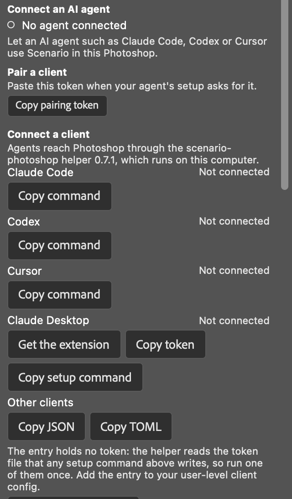
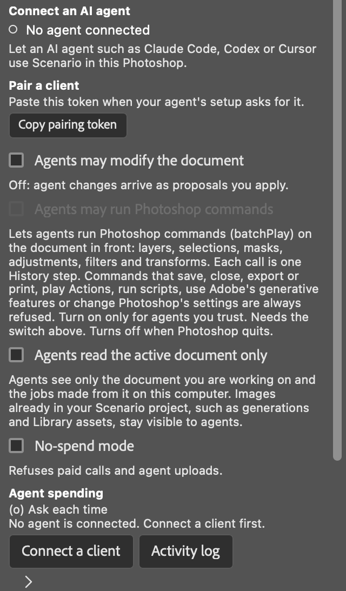
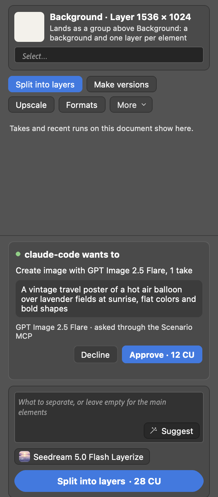
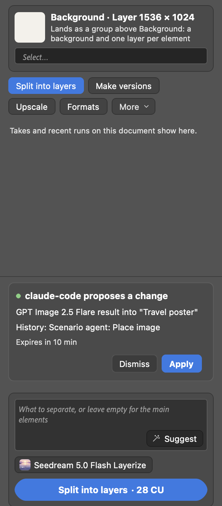

# Agents in Photoshop: the local Scenario MCP server

The Scenario plugin for Photoshop ships a small local Scenario MCP server, `scenario-photoshop`. An AI agent such as Claude Code, Codex, Cursor or Claude Desktop starts it on your computer, and through it the agent can read your open documents, price and run Scenario generations, and land the results as layers. Every credit an agent spends goes through an approval card in the panel, and every change to a document is one History step you can undo.

The server runs on this computer only. It talks to the panel over a local link (`localhost`), never over the network, and it holds no Scenario key: generations run through the plugin with the account you signed in with.

The full tool reference is [spec/MCP.md](spec/MCP.md). Claims carry how they were checked: *verified live* (in Photoshop 27.11 on macOS), *tested automated* or *not tested*.

| Client | How it was checked |
|---|---|
| Claude Code | *Verified live*: setup command, then real Claude Code sessions that read the document, priced, spent through the approval card and landed through the proposal card. The `claude mcp add` registration step is *tested automated* (stand-in CLI); the live runs used `--config` with a temporary file |
| Codex | *Tested headless*: the setup command through the real `codex` CLI with a temporary `CODEX_HOME`. No Codex session against Photoshop was run |
| Cursor | Config file writing *tested automated*. Cursor itself *not tested* (not installed) |
| Claude Desktop | Config file writing *tested automated*. The `.mcpb` extension *not tested* |
| Windows | *Not tested* |

> **Development build.** The helper is not on npm yet, so the commands that read `npx -y @scenario-labs/photoshop-mcp@X.Y.Z` do not work until it is published. From a checkout of this repository, use `node helper/bin/scenario-photoshop.js` in their place and add `--local`, which registers this checkout's helper with your Node:
>
> ```sh
> pbpaste | node helper/bin/scenario-photoshop.js setup claude-code --local --token-stdin
> ```
>
> (after **Copy pairing token** in the panel). This is the route the live runs used.

## Before you start

- Photoshop 2026 (27.x) with the Scenario plugin installed and signed in.
- Node.js 20 or later for Claude Code, Codex and Cursor (`node --version`). Claude Desktop does not need it: its extension runs on the Node that ships with Claude Desktop.
- The agent client itself, installed and signed in.

## Connect a client

1. In the panel, open **Settings** and go to **Connect an AI agent > Connect a client**.

   

2. Find your client's row and use its button (details per client below). The buttons that hold the pairing token clear the clipboard 60 seconds after copying.
3. Restart the client so it starts the helper.
4. Ask the agent something simple, such as "What document is open in Photoshop?". The row turns to **Connected, last call just now**.

### Claude Code

Click **Copy command** on the Claude Code row, paste the line in a terminal and press Return. It looks like this, with your own token and the plugin's helper version:

```sh
SCENARIO_PHOTOSHOP_TOKEN=<token> npx -y @scenario-labs/photoshop-mcp@X.Y.Z setup claude-code
```

The setup command:

- saves the pairing token in `~/.config/scenario-photoshop/token`, readable by your account only (file mode 600, folder 700);
- registers the server with `claude mcp add --scope user`, so it is available in every project. The entry it adds holds no token.

### Codex

Click **Copy command** on the Codex row and run it in a terminal. It does the same as for Claude Code, with `setup codex`, and registers the server with `codex mcp add scenario-photoshop`. The entry in `~/.codex/config.toml` holds no token.

### Cursor

Click **Copy command** on the Cursor row and run it in a terminal. The setup command writes the `scenario-photoshop` entry into `~/.cursor/mcp.json`:

- only that entry is replaced; the rest of the file stays as it was;
- the previous file is kept as `mcp.json.scenario-backup-<time>`;
- a new file is readable by your account only, and a rewritten file keeps its mode;
- a file it cannot parse is left untouched, and the command says so.

The entry holds no token: the helper reads the token file.

### Claude Desktop

1. Click **Get the extension**. It opens the release page of `scenario-photoshop-X.Y.Z.mcpb`.
2. Download the file and double-click it. Claude Desktop installs the extension and asks for the pairing token.
3. Click **Copy token** in the panel and paste it in Claude Desktop's field. Claude Desktop keeps it as a sensitive setting.

If you prefer the token file, **Copy setup command** gives the same terminal command as the other clients, with `setup claude-desktop`. It writes the entry into Claude Desktop's config file the way it does for Cursor.

The release page and the `.mcpb` file come with the first published release; *not tested*.

### Other clients

**Copy JSON** and **Copy TOML** give the server entry for a client that is not listed. Neither holds a token: run one of the setup commands above once, so the token file exists, then add the entry to your user-level client config. Do not put it in a project file such as `.mcp.json` that may be committed.

**Copy skills command** copies `npx skills add scenario-labs/skills`, which installs the Scenario skills for Photoshop work in your agent.

### Where the token goes

- The setup command reads the token from its environment, or from standard input with `--token-stdin`, never from its arguments, which other accounts on the same computer can list.
- The pasted line stays in your shell history. To keep it out, pipe the token in instead, for example after **Copy token**: `pbpaste | npx -y @scenario-labs/photoshop-mcp@X.Y.Z setup claude-code --token-stdin`.
- Clients set up with the setup command share the token file. After **Reset** (Settings > Connect an AI agent > Details, under Pairing token), run one new setup command and every one of them reconnects.
- On Windows the buttons give the PowerShell form: `$env:SCENARIO_PHOTOSHOP_TOKEN='<token>'; npx -y @scenario-labs/photoshop-mcp@X.Y.Z setup <client>; Remove-Item Env:SCENARIO_PHOTOSHOP_TOKEN`.

## What agents may do

**Settings > Connect an AI agent** holds three switches. All are off by default.



| Switch | Off | On |
|---|---|---|
| **Agents may modify the document** | Agents can read documents and run generations, but every result they want to land shows a proposal card with **Apply** and **Dismiss** | Results land at once as one History step "Scenario agent: <action>", with an **Undo** banner. The header shows "Agents can edit" |
| **Agents may run Photoshop commands** | Refused | Agents run Photoshop commands (batchPlay) on the document in front, each call one History step. Commands that save, close, export or print, play Actions, run scripts, use Adobe's generative features or change Photoshop's settings are always refused. Needs the first switch, and turns off when Photoshop quits |
| **Agents read the active document only** | Agents can read every open document | Agents see only the document you are working on and the jobs made from it on this computer |

Agents change only the document in front. The plugin never brings another document forward for an agent; a proposal for another document waits until you bring it forward.

**No-spend mode** refuses every agent request that would spend credits, whatever the other settings say.

## Approvals

### Spending credits

An agent first prices a run (free), then asks to run it. The panel shows a card above the prompt bar: which client asks, what it will make with which model and how many takes, the prompt and the price on the Approve button. **Approve** runs it; **Decline** tells the agent and spends nothing. *Verified live* (approve and decline).



The agent must send back the exact price it was quoted. If the price changed, or the quote is older than its time limit, the request is refused before anything is spent and the agent prices it again. A card left unanswered expires after 10 minutes.

**Agent spending** in Settings changes this for one client session at a time: **Ask each time** (the default) or **Allow**, with a limit per call and a total for the session. **End** stops it at once. The activity log lists every agent request, approved, declined or refused.

### Sending pixels to Scenario

Before an agent sends pixels from a document to Scenario for the first time in a session, the panel asks: "Allow <client> to send pixels from <document> to Scenario for this session?". Declining tells the agent, and nothing is uploaded. *Tested automated*; an approved upload *verified live* through the development loop, the card itself not seen on screen live.

### Landing results

With **Agents may modify the document** off, each result the agent wants to land shows a proposal card: the client, the model and the target document, the History name and the time left. The card shows no picture of the result in this build. **Apply** lands it as one History step; **Dismiss** drops it. A proposal expires after 10 minutes or when the document changes. *Verified live* (Apply).



Results always land as layers with their Scenario metadata (model, prompt, job), the same as results you make yourself, and they show in **Jobs**, marked with the client's name.

## Tools

| Group | Tools |
|---|---|
| Document (read) | `scenario_status`, `document_summary`, `layer_detail`, `preview_document` |
| Scenario (read, free) | `list_models`, `model_schema`, `recommend_models`, `estimate_cost`, `job_status`, `wait_for_job`, `list_local_jobs`, `list_generations`, `list_assets`, `search_assets`, `list_collections`, `inspect_result_previews` |
| Inputs | `capture_reference`, `upload_reference`, `reference_upload_status` |
| Spending | `generate` |
| Recovery | `recover_local_job`, `recover_cloud_job`, `cancel_prepared_job` |
| Document changes (first switch) | `prepare_result_application`, `apply_result_application`, `select_layers`, `set_selection`, `remove_scenario_layers` |
| Photoshop commands (second switch) | `execute_batchplay` |

A typical edit: `document_summary`, `set_selection`, `capture_reference`, `upload_reference` (upload card), `estimate_cost`, `generate` (spend card), `wait_for_job`, `prepare_result_application`, `apply_result_application`.

## Troubleshooting

| What you see | What to do |
|---|---|
| `NotConnected` | Open the Scenario panel in Photoshop. The helper reaches the panel only while it is open |
| `PairingFailed` | The token changed (for example after **Reset** under Details). Run the setup command again from Connect a client |
| `VersionMismatch` | The plugin and the helper versions differ. Connect a client shows the command for the new version |
| `SwitchOff`, or a proposal card instead of a change | Turn on **Agents may modify the document**, or use **Apply** on the card |
| `DocumentNotActive` | Bring the document forward in Photoshop, then ask the agent to retry |
| `NoSpend` | Turn off **No-spend mode** in Settings |
| `QuoteExpired` or `CostMismatch` | Nothing was spent. The agent prices the run again |
| `SpendDeclined` or `UploadDeclined` | You declined the card. Nothing was spent or sent |
| `npx` not found | Install Node.js 20 or later, or use Claude Desktop's extension |
