# User Guide

Scenario for Photoshop, development build 0.7.1. Pictures and recordings in this guide come from real runs in Photoshop 27.11 on macOS with the panel docked at 320 px, at each action's default model and its normal quality; inputs were made with GPT Image 2.5. Claims carry how they were checked: *verified live* (in Photoshop), *tested automated* (test suite, no Photoshop) or *not tested*.

- [Quick start](#quick-start)
- [Find your way around](#find-your-way-around)
- [Actions](#actions)
- [Selection edits: Inside selection or Bolder](#selection-edits-inside-selection-or-bolder)
- [Takes](#takes)
- [References](#references)
- [Style and trained models](#style-and-trained-models)
- [Library](#library)
- [Prices and approval](#prices-and-approval)
- [Jobs and recovery](#jobs-and-recovery)
- [Settings](#settings)
- [Agents](#agents)
- [Where results are saved](#where-results-are-saved)
- [Troubleshooting](#troubleshooting)
- [Not in this build](#not-in-this-build)

## Quick start

From install to a first image in about two minutes, once the package is built: 1 min 53 s measured live with the release package on 2026-10-23, with the clicks done by a script (see the [README](../README.md#install)).

1. **Install** the `.ccx` and restart Photoshop, then open **Plugins > Scenario**. The panel opens on **Connect your Scenario account**.

   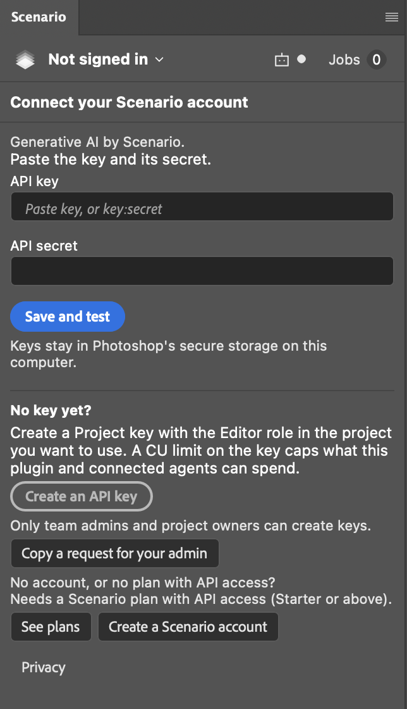

2. **Get a key.** On app.scenario.com, in the project you want to use, create a **Project key** with the **Editor** role. A CU limit on the key caps what this plugin and connected agents can spend. Only team admins and project owners can create keys; **Copy a request for your admin** prepares the message for them.
3. **Sign in.** Paste the key and the secret (pasting `key:secret`, or the two on two lines, fills both fields) and click **Save and test**. The plugin checks the key with two free reads and keeps it in Photoshop's secure storage on this computer. *Verified live* with the release package: `key:secret` pasted into the key field, then **Save and test**, which answered in about a second.
4. **Make a new document** with **File > New** (Photoshop hides docked panels on its Home screen, so the panel shows once a document is open). On a blank canvas the panel opens on **Create image**: type a prompt and click the button, which shows its price. The image is made at the canvas's size and lands as a layer above the Background. On an image or a layer, **New layer** does the same.
5. The context card shows the progress (Queued, Generating, Downloading), then the image lands as a new layer in one History state. *Verified live*.

## Find your way around

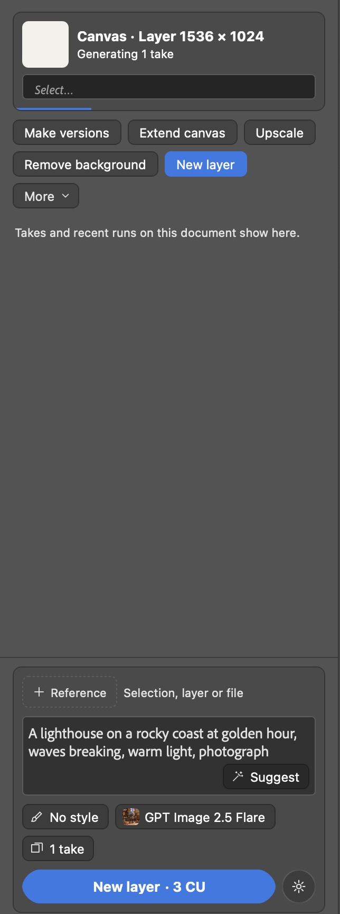

From top to bottom:

- **Header**: the project name (click to switch projects), the agent icon with its dot, and **Jobs** with a count.
- **Context card**: a picture of what the panel will work on and where the result lands ("Lands inside the selection, masked", "Lands as a new layer"), with the progress during a run. Its **Select…** field is [Select by description](#actions).
- **Action chips**: the actions for this context, at most six, then **More** for the others, grouped. A pin in **More** adds an action to the chips.
- **Takes and Recent**: the last run's takes, then the other runs placed in this document.
- **Composer**, pinned at the bottom: **+ Reference**, the prompt (with **Suggest**), the chips that set the model and its options (each shows its value), and the action button with its price. The gear icon holds the quality level and advanced options. To write a longer prompt, drag the grip on the composer's top edge up to make the box taller; double-click the grip to go back. The panel keeps the height for next time.

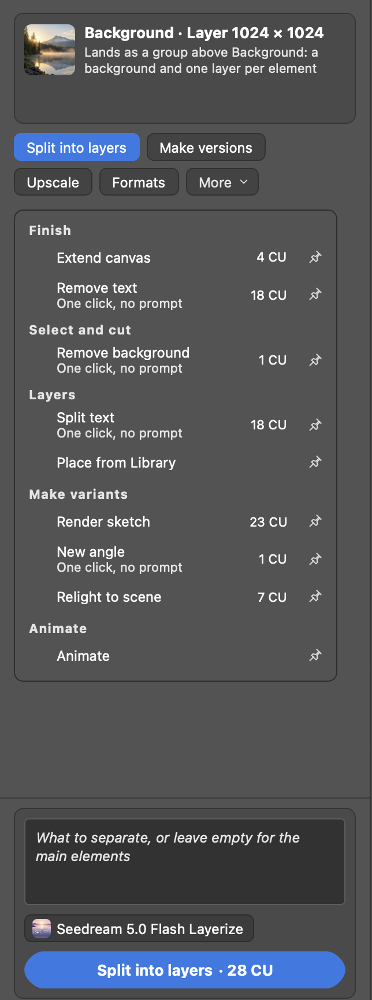

## Actions

What the panel offers depends on what is selected. Each action below was *verified live* on 27.11 unless marked; the pictures are the before and the result of that run.

### Blank document

A document of one Background of a single color, as **File > New** makes it, offers **Create image** first: made at the canvas's aspect (the model's nearest size), in up to four takes, landing as a layer at canvas size in the same document. **Place from Library** is beside it. *Verified live* (the context and its price); *tested automated* (the landing).

### Selection actions

Draw a selection with any Photoshop tool. The context card reads "Selection W × H on <layer>".

**Replace inside**: describe what goes inside the selection. Default model Ideogram 4.5 Precise Edit (Inside selection) or GPT Image 2.5 Flare (Bolder), see [the next section](#selection-edits-inside-selection-or-bolder).

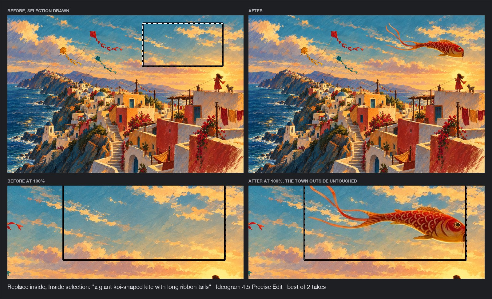

**Remove**: removes what is inside the selection and fills it with what should be behind. No prompt needed (a built-in one is sent).

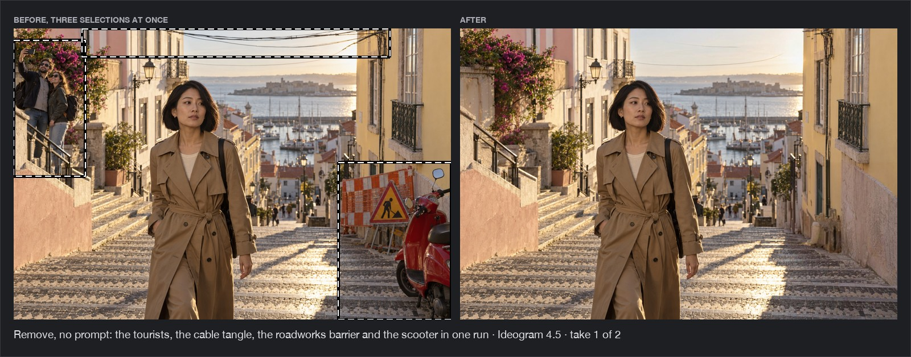

**Cut out subject**: the subject inside the selection, on a new layer with a transparent background. The layer stays as it was and the selection is dropped in the same History state.

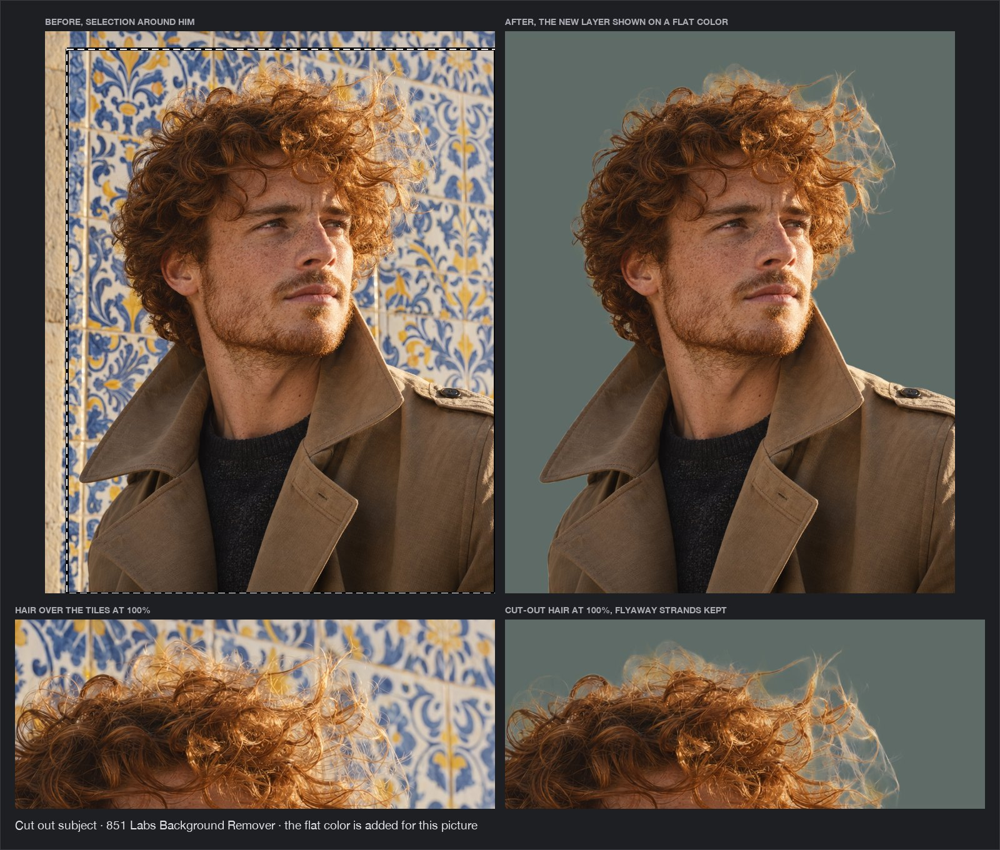

**Select by description**: type what to select in the context card's **Select…** field ("all the sailboats"), click **Select**. The masks the model finds become a Photoshop selection, ready for the next action.

**New layer** in a selection: a new element drawn for the selection, sized to it and placed inside it. **Lands: Cut out** (the default) asks the model for a transparent background; when the model still returns a full picture, Photoshop's own Remove Background cuts it at placement, as a layer mask you can paint on. **Full frame** keeps the model's own background inside the selection box.

**Make versions** also works on a selection.

### Layer and image actions

With no selection, the panel works on the active layer, or the whole image for a flat document.

**Make versions**: variations of the layer, or the change you describe, as takes to compare.

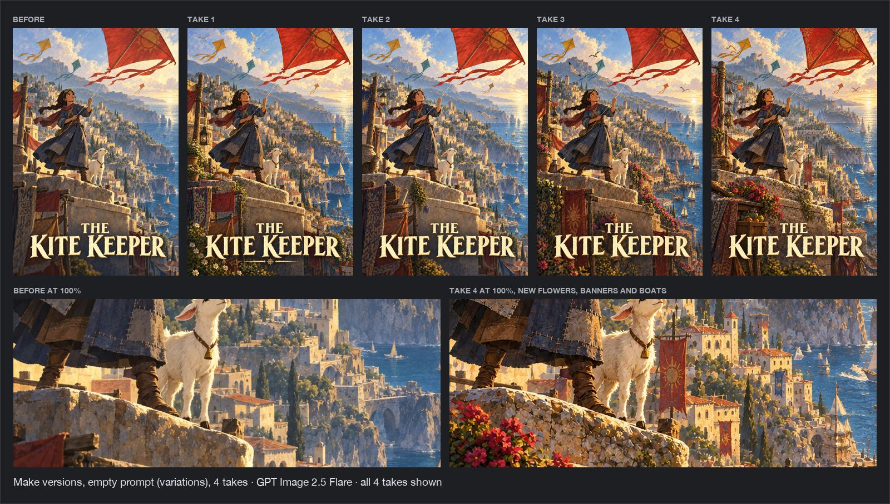

**New layer**: a new image on a layer above, from a prompt.

**Upscale**: 2x or the other factors the model offers (Topaz Image Upscale), from all visible layers, opened as a new document at the larger size. The result card compares the same region at 100%.

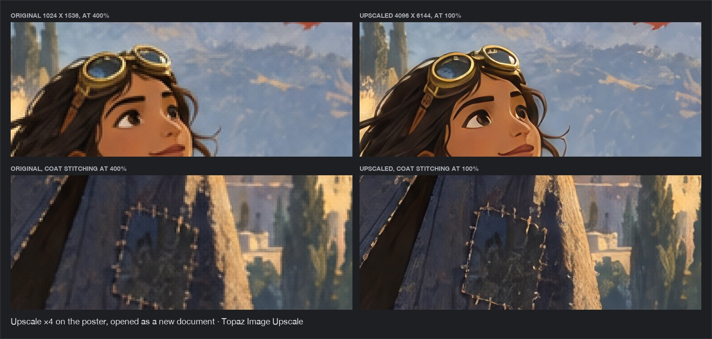

**Remove background**: one click (851 Labs Background Remover); lands as a mask on the layer, so the hidden pixels stay. **Cut out to a new layer** (More) keeps the layer as it is and puts the subject on a masked copy above.

**Add background**: on a cut-out layer, describe the scene; it lands below the layer at canvas size.

**Render sketch** (More > Make variants): turns a line drawing into a finished image from your prompt (GPT Image 2.5 Sunburst).

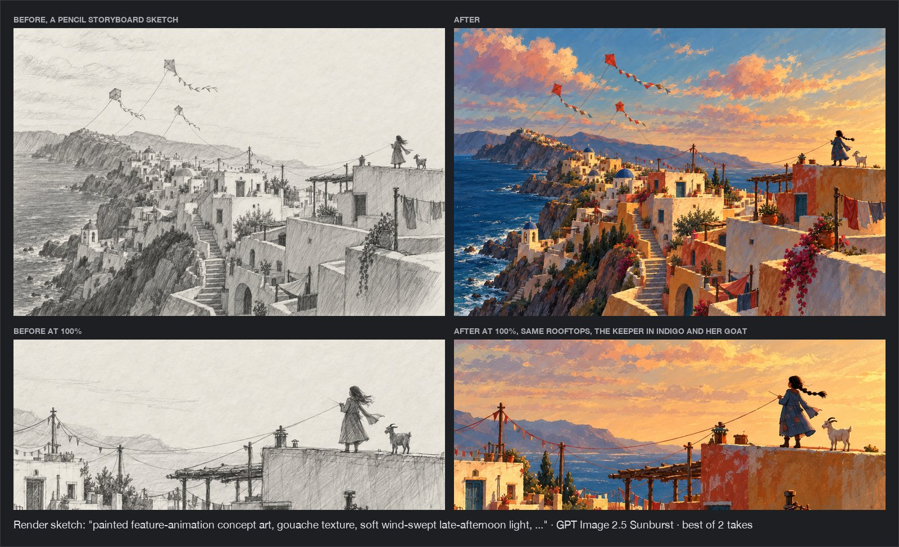

**New angle** (More > Make variants): Turn left 45°, Turn right 45°, Side view, Back view or From above. No prompt.

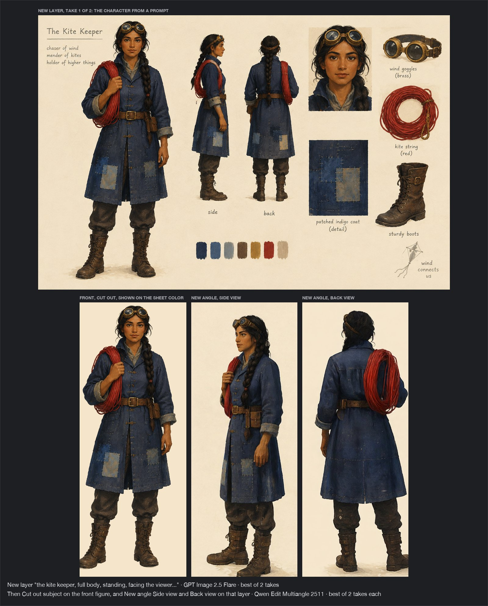

**Split into layers**: rebuilds the image as a group: a clean background and one layer per element, each placed where it was.

**Remove text** (More > Finish): the same image without its text, as a new layer above. **Split text** (More > Layers) gives the clean base and the text on its own layer instead.

**Formats**: reframes the image to Story 9:16, Feed 4:5, Square 1:1 or Wide 16:9 (Scenario Smart Reframe), as an artboard in a new "<title> formats" document. Type layers stay out of the reframe: each title is laid out again on the artboard at its place in the frame, still editable. Each new format is added to the same document, beside the others. If a subject gets cut at the edge, name it in the prompt ("keep the kite and the keeper whole in frame") and run that format again.

**Animate** (More > Animate): a short clip from the image and your prompt (Minimax H3 Fast, 5 s by default). The clip opens as a new document and the MP4 is saved in the output folder. **Frame to layer** brings its last frame back as a layer.

**Relight to scene** (More > Make variants): relights a cut-out or split element to match the visible image. *Verified live* on 0.6.2; no picture in this guide.

**Extend canvas** (More > Finish): grows the canvas to a ratio and fills the new area. The default model is Reframe at 2K, which redraws the frame around the original; it costs more than the earlier default (the button shows the price), and it has no per-side growth (pick GPT Image 2.5 Flare for **+20% each side**). Look at the old edge at 100% before keeping the result; see [Known limitations](KNOWN_LIMITATIONS.md).

**Place from Library** (More > Layers): see [Library](#library).

## Selection edits: Inside selection or Bolder

Replace inside has an **Edit** chip with two modes, each with its price:

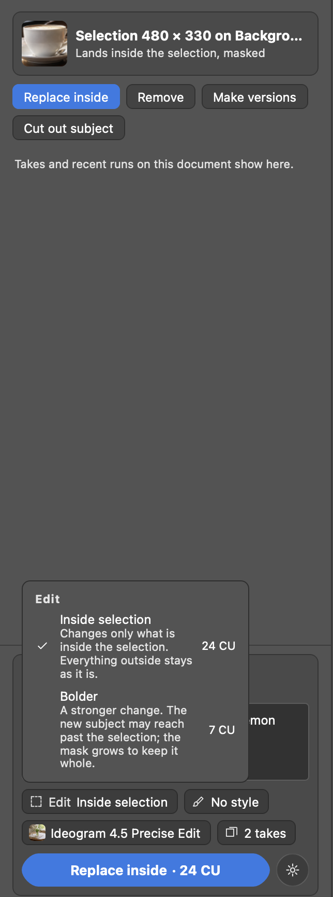

- **Inside selection** (Ideogram 4.5 Precise Edit): changes only what is inside the selection; everything outside stays as it is. Good for a change that fits the shape you drew.
- **Bolder** (GPT Image 2.5 Flare): a stronger change. The new subject may reach past the selection, and the layer mask grows to keep it whole. Good when the new object is taller or wider than the old one, as with the dragon below.

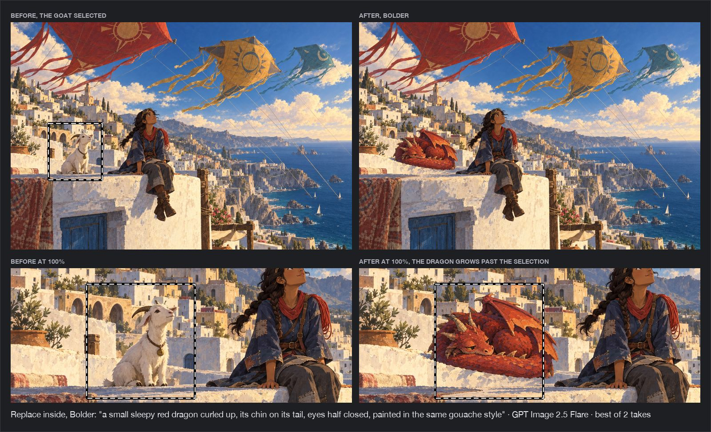

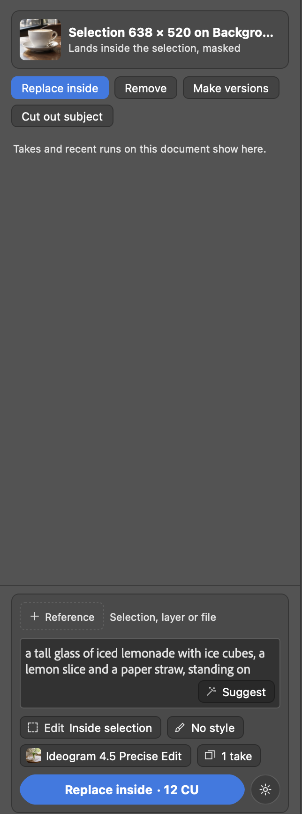 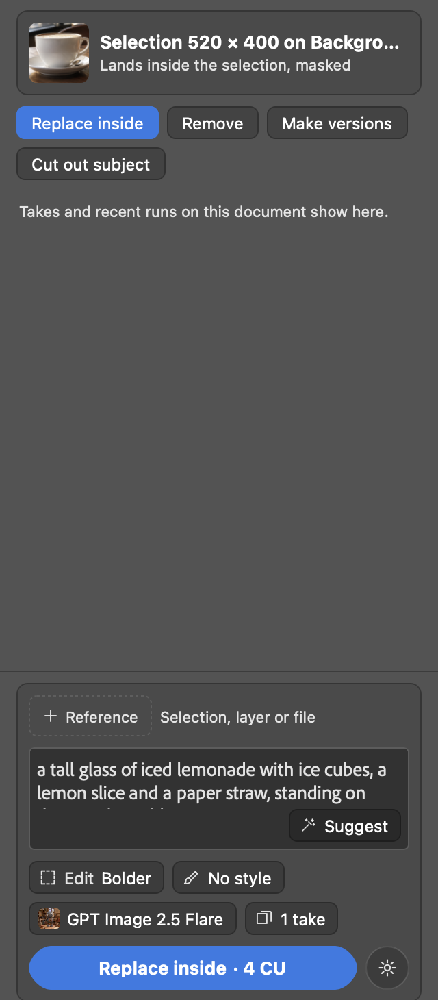

After a run, the take offers **Try Bolder** or **Try Inside selection** to run the other mode.

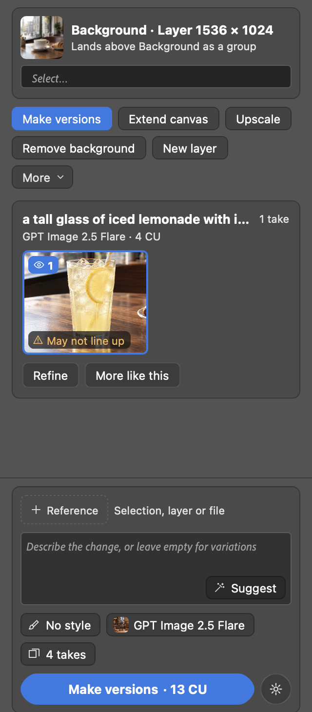

*The Bolder take above carries **May not line up**: the glass reaches past the selection, as Bolder allows.*

Tips:

- A feathered selection blends the edge. Leave some margin around the object.
- With Inside selection, an object taller than the selection is cut at its edge: draw the selection to the size of the new object, or use Bolder.
- A take can carry a check badge: **Edges ok**, **Edge may show** (a lighter or darker patch at the selection edge, or on Extend canvas a step or a repeated detail at the old edge), **May not line up**, **Part unchanged** or **Spills past**. The checks look at tone and alignment around the edge; they do not catch every visible patch, so look at the result.

*3x speed. [MP4](media/video/selection-edit.mp4).*

## Takes

When an action makes several takes, they land as a group with take 1 visible, and the Takes card shows one tile per take. A single take lands as a layer with the same card.

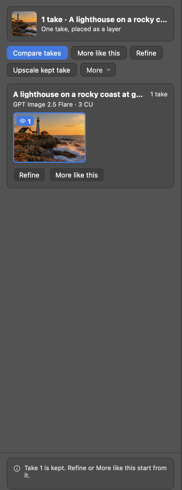

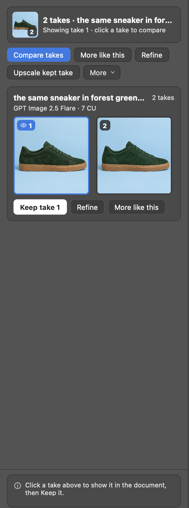

- Click a tile to show that take in the document (one History state).
- **Keep take N** removes the other takes from the document; their files stay in the output folder and in Jobs.
- **Refine** keeps the shown take, loads its selection back and opens Replace inside on it.
- **More like this** runs again with the shown take as a reference.
- **Upscale kept take** upscales the take you kept.

Select the group in the Layers panel later, even after a restart, and the card comes back from the layers' metadata. *Verified live*.

## References

**+ Reference** adds an image the model uses as a reference: the selection's box, the active layer, all visible, a PNG or JPEG file, or a Library image. The hint next to it reads "Selection, layer or file". Layers pinned as document references (Character, Set, Style, Product) are kept in the document and come back with the file. References upload when you click the action button. *Verified live* (a layer reference on Replace inside, a Library reference).

On Replace inside, a reference of a whole scene may be copied into the selection: use an object or a style as the reference. The panel says so under the references row. *Tested automated*; seen live on 0.7.0, when a reference of the same scene was redrawn into the selection box.

## Style and trained models

The **Style** chip offers **No style** (the model's own look), **Match an image** (a picture goes as the style reference, with any model that takes references) and the project's trained styles.

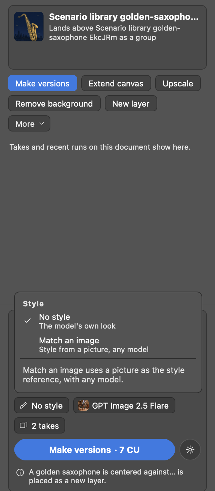

The **Model** chip lists the recommended model for the action and up to eight catalog models that can do it, with their prices for this document as the price checks come back (some rows can stay without a price), then **All models…**.

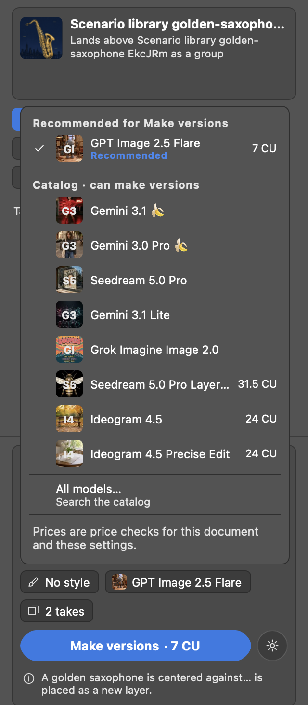

**All models…** opens the picker: search, the Image, Edit, Enhance and Trained tabs, filters (All, Favorites, Recommended, References), and a star to keep favorites.

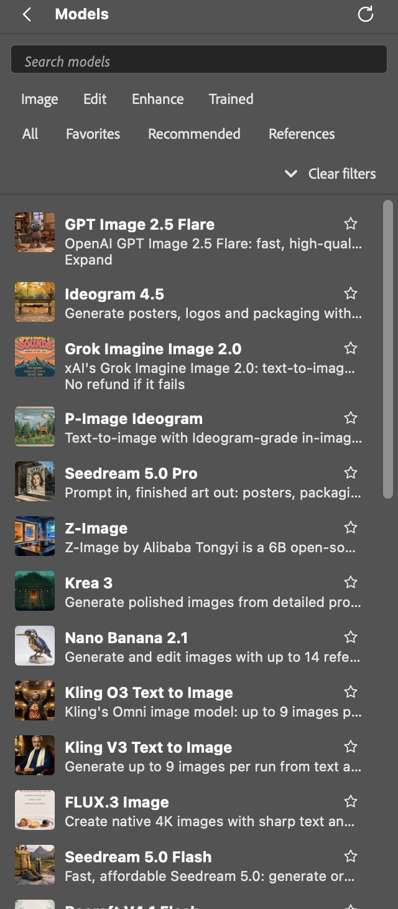

**Trained models.** **Run with** a trained model, the project's or a public one, runs it on its base model for the selected action, with its trigger words before your prompt. A trained style runs on the model it was trained on, and a style and a model stack on one base when it takes both. *Verified live* (M7): Run with, Make new and a selection edit with FLUX.1 Dev and FLUX.2 Dev trained models. *Not tested* live: the Z-Image route and a stacked run.

## Library

**Place from Library** (More > Layers) opens a grid of the project's images with a search field and the filters All, Generated, Edited and Uploaded, then **Show more**. Click an image to place it as a new layer at its own size, never enlarged, centered, in one History state. **+ Reference > Library** uses the same grid. *Verified live*.

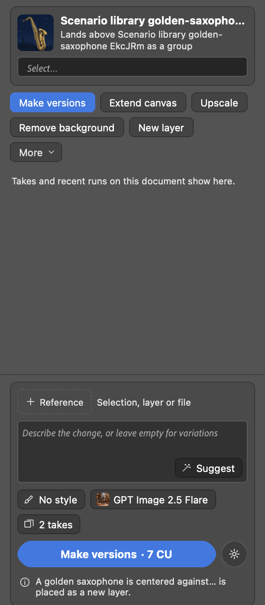

Dragging from the grid is not in this build.

## Prices and approval

- The price is checked for free (a dry run, which creates no job) about half a second after each change, and shows on the button: exact (`12 CU`, `Free`), a range, or `from N CU`.
- An action that needs a prompt reads **Fill in the prompt to see the price** until it has one.
- **A click on a priced button is the approval.** Above 100 CU, for the top of a range and for any `from` price, a card asks first.
- The request is built again at the click. If the document, the selection or a setting changed since the price check, nothing is sent.
- If the price changes once references or captures are uploaded, the panel stops and asks again. Nothing was spent. *Verified live* (New angle: 1 CU before the upload, 6 CU after).

  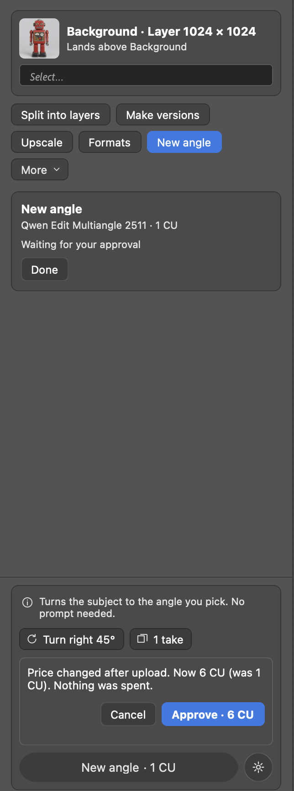

- A failed job shows "Refunded by Scenario"; a model without refunds says so before you click.
- A CU limit on your key caps what the plugin and agents can spend.

## Jobs and recovery

**Jobs** in the header opens the six newest jobs on this computer; **All jobs** opens the full list with each job's status, price words ("quoted 6, charged 6 CU") and its actions. *Verified live*.

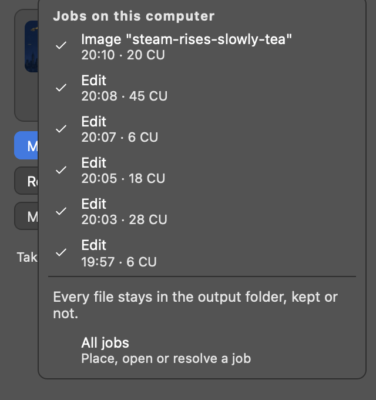

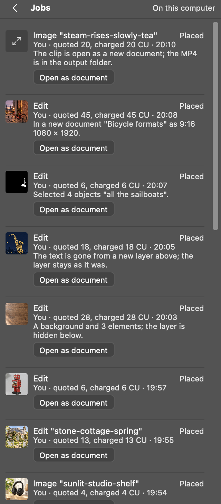

- Each job is written to disk before anything is sent, so Jobs survives a restart of Photoshop. *Verified live* (M5, six restart points).
- After a restart: a job that was uploading or waiting for approval becomes not sent (nothing charged); generating jobs resume; finished ones download again; nothing lands in a document by itself.
- A job whose request may or may not have reached Scenario (no answer, lost connection) is **Unknown**. The plugin looks it up on Scenario: **Link** continues a match; **Mark not sent** appears only when a complete look-up found none. The same request is blocked until then, so nothing is paid twice.
- **Place**, **Place in current document** and **Open as document** land a finished result where you choose. A result goes back to the document it started from, while that document is open and in front.
- Downloads can be stopped and resumed.

## Settings

Open **Settings** from the panel menu.

- **Account**: the signed-in project, **Add a key for another project**, **Test connection**, **Sign out** (removes the key from this computer; delete it on app.scenario.com to revoke it).
- **Connect an AI agent**: link status, the pairing token, the three agent switches, No-spend mode, agent spending, **Connect a client** and the activity log. See [Agents](#agents).

The panel menu also has Projects, Diagnostics, Help, About and Sign Out.

## Agents

An agent such as Claude Code can work in this Photoshop through the plugin's local Scenario MCP server. Every credit it spends goes through a card in the panel, and with **Agents may modify the document** off, every result it wants to land waits on a proposal card.

Setup, switches, approvals and the tool list: [MCP.md](MCP.md).

## Where results are saved

Every result is saved before it is placed, kept or not, in the plugin's output folder:

`~/Library/Application Support/Adobe/UXP/PluginsStorage/PHSP/27/External/com.scenario.photoshop/PluginData/Scenario/<kind>/<date>/`

Results are also in your Scenario project, so you find them again in the Library and on app.scenario.com. Each placed layer carries Scenario metadata (model, prompt, settings, job, prices) in its XMP, which survives saving the PSD.

## Troubleshooting

| What you see | What to do |
|---|---|
| The panel is empty on Photoshop's Home screen | Open or create a document. Photoshop hides docked panels on Home |
| "Scenario did not accept this key and secret." | Check you copied both, from a Project key. **Enter key again** or **Create an API key** |
| "API keys need a Starter plan or above. This team's plan has no API access." | Use a team on a plan with API access, or **Open plans**. **Copy a request for your admin** prepares the message |
| A Team (Organization) key or a Reader key | Use a Project key with the Editor role |
| **Fill in the prompt to see the price** | The action needs a prompt |
| A card says the price changed | Nothing was spent. **Approve** at the new price or **Cancel** |
| A job is **Unknown** | Open Jobs and let it look the job up; **Link** or **Mark not sent** |
| A result did not land | Bring the document it started from to the front, then **Place** in Jobs, or **Open as document** |
| "No connection to Scenario. Check your network." | Check the network, then **Retry**. A job that was being sent when the connection dropped shows as **Unknown** in Jobs until it is looked up |
| An agent says `NotConnected` | Open the Scenario panel; the helper reaches it only while it is open |

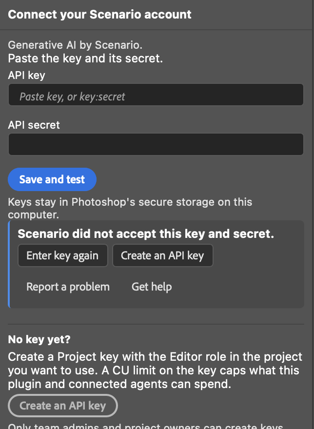 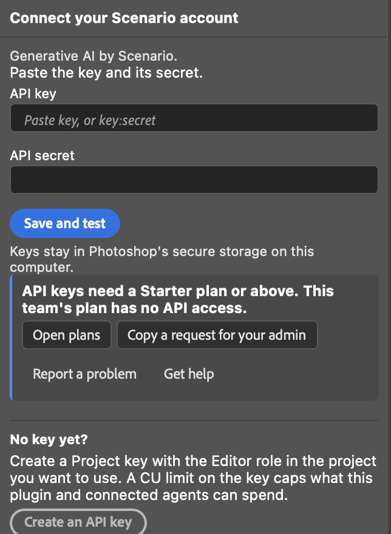

*Drawn from the panel's own failure copy; the errors themselves were not produced live in this pass.*

**Copy diagnostics** (Settings, or **Diagnostics…** in the panel menu) shows a short report before it copies it, for a bug report: versions, switch states, job counts and the last error types, with no prompts, names, ids, paths, keys or tokens. *Tested automated*. See [SECURITY.md](../SECURITY.md) for security issues.

## Not in this build

- Start a set, Same action on each, and Run a workflow.
- Drag and drop onto the panel or from the Library grid.
- Windows: built for it, *not tested*.
- Photoshop versions before 27.11: *not tested*.

The full list: [Known limitations](KNOWN_LIMITATIONS.md).
